<!-- generated by build_erd.py from ../03-database/schema.sql -- DO NOT EDIT BY HAND -->
# ERD — ระบบจองห้องพัก (Room Booking System)

แผนภาพนี้ **generate อัตโนมัติ** จาก [`../03-database/schema.sql`](../03-database/schema.sql)
ด้วย [`build_erd.py`](build_erd.py) — ทุกตาราง / คอลัมน์ / คีย์ / ความสัมพันธ์
ตรงกับ DDL จริงเสมอ (รันสคริปต์ใหม่เมื่อ schema เปลี่ยน)

- **19 ตาราง**, **25 ความสัมพันธ์ (FK)** — 3 เส้นเป็น 1:0..1 (FK มี UNIQUE), ที่เหลือ 1:N
- notation: crow's foot — `||--o{` = one‑to‑many, `||--o|` = one‑to‑(zero‑or‑one);
  ปลายฝั่งแม่เป็น `|o` เมื่อ FK เป็น NULL ได้ (ลูกไม่จำเป็นต้องมีแม่ เช่น งานซ่อมพื้นที่ส่วนกลาง)
- `(one live)` = UNIQUE เฉพาะแถวที่ยังใช้งาน (partial index) เช่น ใบแจ้งหนี้ที่ไม่ void มีได้ใบเดียวต่อการจอง
- คอลัมน์กำกับ `PK` / `FK` / `UK`; หมายเหตุในเครื่องหมายคำพูดบอก target ของ FK และ `NOT NULL`
- draw.io / SVG จัดเป็น **คอลัมน์ตามกลุ่ม** (สี): people · auth · catalog · booking · billing · ops

ฉบับอื่น: [`ERD.drawio`](ERD.drawio) (draw.io) · [`ERD.svg`](ERD.svg) (ภาพเวกเตอร์ ซูมได้) ·
สรุปเชิงข้อความ + normalization 1NF→3NF ใน [`relational-schema.md`](relational-schema.md)

```mermaid
erDiagram
    APP_USER |o--o{ AUDIT_LOG : actor_user_id
    APP_USER |o--o{ AUTH_EVENT : user_id
    BOOKING ||--o{ BOOKING_ROOM : booking_id
    BOOKING ||--o{ BOOKING_SERVICE : booking_id
    BOOKING |o--o{ HOUSEKEEPING_TASK : booking_id
    BOOKING ||--o{ INVOICE : "booking_id (one live)"
    BOOKING ||--o{ PAYMENT : booking_id
    BOOKING ||--o| REVIEW : booking_id
    CUSTOMER |o--o| APP_USER : customer_id
    CUSTOMER ||--o{ BOOKING : customer_id
    INVOICE ||--o{ INVOICE_LINE : invoice_id
    ROOM ||--o{ BOOKING_ROOM : room_id
    ROOM ||--o{ HOUSEKEEPING_TASK : room_id
    ROOM |o--o{ MAINTENANCE_TICKET : room_id
    ROOM ||--o{ ROOM_STATUS_LOG : room_id
    ROOM_TYPE ||--o{ RATE_PLAN : room_type_id
    ROOM_TYPE ||--o{ ROOM : room_type_id
    SERVICE ||--o{ BOOKING_SERVICE : service_id
    STAFF |o--o| APP_USER : staff_id
    STAFF ||--o{ BOOKING : staff_id
    STAFF |o--o{ HOUSEKEEPING_TASK : assigned_to
    STAFF |o--o{ INVOICE : issued_by
    STAFF |o--o{ MAINTENANCE_TICKET : assigned_to
    STAFF ||--o{ MAINTENANCE_TICKET : reported_by
    STAFF ||--o{ ROOM_STATUS_LOG : changed_by

    ROOM_TYPE {
        int room_type_id PK
        varchar name UK "NOT NULL, UNIQUE"
        varchar description
        numeric base_price_per_night "NOT NULL"
        int max_occupancy "NOT NULL"
    }
    ROOM {
        int room_id PK
        varchar room_number UK "NOT NULL, UNIQUE"
        int floor "NOT NULL"
        int room_type_id FK "-> room_type, NOT NULL"
        varchar status "NOT NULL"
        varchar note
    }
    CUSTOMER {
        int customer_id PK
        varchar first_name "NOT NULL"
        varchar last_name "NOT NULL"
        varchar email UK "NOT NULL, UNIQUE"
        varchar phone
        varchar id_card_no
        timestamptz created_at "NOT NULL"
    }
    STAFF {
        int staff_id PK
        varchar first_name "NOT NULL"
        varchar last_name "NOT NULL"
        varchar email UK "NOT NULL, UNIQUE"
        varchar phone
        varchar role "NOT NULL"
        date hired_at "NOT NULL"
        boolean is_active "NOT NULL"
    }
    SERVICE {
        int service_id PK
        varchar name UK "NOT NULL, UNIQUE"
        numeric price "NOT NULL"
        varchar description
        boolean is_active "NOT NULL"
    }
    APP_USER {
        int user_id PK
        varchar username UK "NOT NULL, UNIQUE"
        varchar email UK "NOT NULL, UNIQUE"
        varchar password_hash "NOT NULL"
        varchar role "NOT NULL"
        int customer_id FK "-> customer"
        int staff_id FK "-> staff"
        boolean is_active "NOT NULL"
        int failed_login_count "NOT NULL"
        timestamptz locked_until
        timestamptz last_login_at
        timestamptz password_changed_at "NOT NULL"
        int token_version "NOT NULL"
        timestamptz created_at "NOT NULL"
    }
    AUTH_EVENT {
        int event_id PK
        int user_id FK "-> app_user"
        varchar username_tried
        varchar event_type "NOT NULL"
        inet ip_address
        varchar user_agent
        timestamptz created_at "NOT NULL"
    }
    BOOKING {
        int booking_id PK
        int customer_id FK "-> customer, NOT NULL"
        int staff_id FK "-> staff, NOT NULL"
        timestamptz booking_date "NOT NULL"
        date check_in_date "NOT NULL"
        date check_out_date "NOT NULL"
        int num_guests "NOT NULL"
        varchar status "NOT NULL"
        varchar note
    }
    BOOKING_ROOM {
        int booking_room_id PK
        int booking_id FK "-> booking, NOT NULL"
        int room_id FK "-> room, NOT NULL"
        numeric price_per_night "NOT NULL"
    }
    BOOKING_SERVICE {
        int booking_service_id PK
        int booking_id FK "-> booking, NOT NULL"
        int service_id FK "-> service, NOT NULL"
        int quantity "NOT NULL"
        numeric unit_price "NOT NULL"
    }
    PAYMENT {
        int payment_id PK
        int booking_id FK "-> booking, NOT NULL"
        numeric amount "NOT NULL"
        varchar method "NOT NULL"
        varchar status "NOT NULL"
        timestamptz paid_at
        varchar reference_no
    }
    REVIEW {
        int review_id PK
        int booking_id FK "-> booking, NOT NULL"
        int rating "NOT NULL"
        varchar comment
        timestamptz created_at "NOT NULL"
    }
    ROOM_STATUS_LOG {
        int log_id PK
        int room_id FK "-> room, NOT NULL"
        int changed_by FK "-> staff, NOT NULL"
        varchar old_status "NOT NULL"
        varchar new_status "NOT NULL"
        timestamptz changed_at "NOT NULL"
    }
    RATE_PLAN {
        int rate_plan_id PK
        int room_type_id FK "-> room_type, NOT NULL"
        varchar name "NOT NULL"
        varchar kind "NOT NULL"
        numeric price_per_night "NOT NULL"
        date valid_from "NOT NULL"
        date valid_to "NOT NULL"
        boolean applies_weekday "NOT NULL"
        boolean applies_weekend "NOT NULL"
        int priority "NOT NULL"
        boolean is_active "NOT NULL"
    }
    INVOICE {
        int invoice_id PK
        int booking_id FK "-> booking, NOT NULL"
        varchar invoice_no UK "NOT NULL, UNIQUE"
        int issued_by FK "-> staff"
        timestamptz issued_at "NOT NULL"
        varchar status "NOT NULL"
        numeric tax_rate "NOT NULL"
        numeric subtotal "NOT NULL"
        numeric tax_amount "NOT NULL"
        numeric total "NOT NULL"
        varchar note
    }
    INVOICE_LINE {
        int invoice_line_id PK
        int invoice_id FK "-> invoice, NOT NULL"
        int line_no "NOT NULL"
        varchar line_type "NOT NULL"
        varchar description "NOT NULL"
        numeric quantity "NOT NULL"
        numeric unit_price "NOT NULL"
        numeric amount "NOT NULL"
    }
    HOUSEKEEPING_TASK {
        int task_id PK
        int room_id FK "-> room, NOT NULL"
        int booking_id FK "-> booking"
        varchar task_type "NOT NULL"
        varchar status "NOT NULL"
        date scheduled_for "NOT NULL"
        int assigned_to FK "-> staff"
        timestamptz created_at "NOT NULL"
        timestamptz started_at
        timestamptz completed_at
        varchar note
    }
    MAINTENANCE_TICKET {
        int ticket_id PK
        int room_id FK "-> room"
        int reported_by FK "-> staff, NOT NULL"
        int assigned_to FK "-> staff"
        varchar category "NOT NULL"
        varchar priority "NOT NULL"
        varchar status "NOT NULL"
        varchar title "NOT NULL"
        varchar description
        timestamptz created_at "NOT NULL"
        timestamptz resolved_at
        varchar resolution
    }
    AUDIT_LOG {
        bigint audit_id PK
        timestamptz at "NOT NULL"
        int actor_user_id FK "-> app_user"
        varchar actor_label
        varchar action "NOT NULL"
        varchar entity_type "NOT NULL"
        varchar entity_id
        varchar summary
        jsonb data
    }
```

