# Relational Schema & Normalization — ระบบจองห้องพัก

อ้างอิงจาก `01-proposal/proposal.md` — เอกสารนี้แปลง ER เป็นตารางเชิงสัมพันธ์
พร้อมระบุ PK / FK / ข้อจำกัด และแสดงว่าอยู่ใน **3NF**

---

## 1. ER Diagram (ฉบับย่อ — วาดจริงบน Lucidchart)

```mermaid
erDiagram
    ROOM_TYPE   ||--o{ ROOM            : "จัดเป็น"
    ROOM        ||--o{ BOOKING_ROOM    : "ถูกจองใน"
    BOOKING     ||--o{ BOOKING_ROOM    : "ประกอบด้วย"
    CUSTOMER    ||--o{ BOOKING         : "ทำการจอง"
    STAFF       ||--o{ BOOKING         : "รับผิดชอบ"
    BOOKING     ||--o{ BOOKING_SERVICE : "มีบริการเสริม"
    SERVICE     ||--o{ BOOKING_SERVICE : "ถูกเลือกใน"
    BOOKING     ||--o{ PAYMENT         : "ชำระด้วย"
    BOOKING     ||--o| REVIEW          : "ถูกรีวิวโดย"
    ROOM        ||--o{ ROOM_STATUS_LOG : "มีประวัติ"
    STAFF       ||--o{ ROOM_STATUS_LOG : "เปลี่ยนโดย"
    CUSTOMER    ||--o| APP_USER        : "มีบัญชี"
    STAFF       ||--o| APP_USER        : "มีบัญชี"
    APP_USER    ||--o{ AUTH_EVENT      : "บันทึกเหตุการณ์"
    APP_USER    ||--o{ AUDIT_LOG        : "ทำรายการ"
    ROOM_TYPE   ||--o{ RATE_PLAN        : "ตั้งราคาตามช่วง"
    BOOKING     ||--o| INVOICE          : "ออกใบแจ้งหนี้"
    INVOICE     ||--o{ INVOICE_LINE     : "แยกบรรทัด"
    ROOM        ||--o{ HOUSEKEEPING_TASK: "ต้องทำความสะอาด"
    BOOKING     ||--o{ HOUSEKEEPING_TASK: "หลังเช็คเอาท์"
    STAFF       ||--o{ HOUSEKEEPING_TASK: "รับผิดชอบ"
    ROOM        ||--o{ MAINTENANCE_TICKET : "ถูกแจ้งซ่อม"
    STAFF       ||--o{ MAINTENANCE_TICKET : "แจ้ง/รับงาน"

    ROOM_TYPE {
        int      room_type_id PK
        varchar  name
        varchar  description
        numeric  base_price_per_night
        int      max_occupancy
    }
    ROOM {
        int      room_id PK
        varchar  room_number UK
        int      floor
        int      room_type_id FK
        varchar  status
        varchar  note
    }
    CUSTOMER {
        int         customer_id PK
        varchar     first_name
        varchar     last_name
        varchar     email UK
        varchar     phone
        varchar     id_card_no
        timestamptz created_at
    }
    STAFF {
        int         staff_id PK
        varchar     first_name
        varchar     last_name
        varchar     email UK
        varchar     phone
        varchar     role
        date        hired_at
        boolean     is_active
    }
    BOOKING {
        int         booking_id PK
        int         customer_id FK
        int         staff_id FK
        timestamptz booking_date
        date        check_in_date
        date        check_out_date
        int         num_guests
        varchar     status
        varchar     note
    }
    BOOKING_ROOM {
        int      booking_room_id PK
        int      booking_id FK
        int      room_id FK
        numeric  price_per_night
    }
    SERVICE {
        int      service_id PK
        varchar  name
        numeric  price
        varchar  description
        boolean  is_active
    }
    BOOKING_SERVICE {
        int      booking_service_id PK
        int      booking_id FK
        int      service_id FK
        int      quantity
        numeric  unit_price
    }
    PAYMENT {
        int         payment_id PK
        int         booking_id FK
        numeric     amount
        varchar     method
        varchar     status
        timestamptz paid_at
        varchar     reference_no
    }
    REVIEW {
        int         review_id PK
        int         booking_id FK,UK
        int         rating
        varchar     comment
        timestamptz created_at
    }
    ROOM_STATUS_LOG {
        int         log_id PK
        int         room_id FK
        int         changed_by FK
        varchar     old_status
        varchar     new_status
        timestamptz changed_at
    }
    APP_USER {
        int         user_id PK
        varchar     username UK
        varchar     email UK
        varchar     password_hash
        varchar     role
        int         customer_id FK
        int         staff_id FK
        boolean     is_active
        int         failed_login_count
        timestamptz locked_until
    }
    AUTH_EVENT {
        int         event_id PK
        int         user_id FK
        varchar     username_tried
        varchar     event_type
        inet        ip_address
        timestamptz created_at
    }
```

---

## 2. Relational Schema (รูปแบบข้อความ)

ขีดเส้นใต้ = Primary Key, *ตัวเอียง* = Foreign Key

- **room_type**(<u>room_type_id</u>, name, description, base_price_per_night, max_occupancy)
- **room**(<u>room_id</u>, room_number, floor, *room_type_id*, status, note)
  - UNIQUE(room_number); status ∈ {available, **cleaning**, maintenance, closed}
  - เก็บเฉพาะสถานะ *ทางกายภาพ* ของห้อง — "จองแล้ว/เข้าพักอยู่" อนุมานจาก `booking` (ไม่เก็บซ้ำ)
- **customer**(<u>customer_id</u>, first_name, last_name, email, phone, id_card_no, created_at)
  - UNIQUE(email)
- **staff**(<u>staff_id</u>, first_name, last_name, email, phone, role, hired_at, is_active)
  - UNIQUE(email); role ∈ {receptionist, housekeeping, accounting, manager, admin}
- **booking**(<u>booking_id</u>, *customer_id*, *staff_id*, booking_date, check_in_date, check_out_date, num_guests, status, note)
  - CHECK(check_out_date > check_in_date); status ∈ {pending, confirmed, checked_in, checked_out, cancelled}
- **booking_room**(<u>booking_room_id</u>, *booking_id*, *room_id*, price_per_night)
  - UNIQUE(booking_id, room_id)
- **service**(<u>service_id</u>, name, price, description, is_active)
- **booking_service**(<u>booking_service_id</u>, *booking_id*, *service_id*, quantity, unit_price)
  - UNIQUE(booking_id, service_id); CHECK(quantity > 0)
- **payment**(<u>payment_id</u>, *booking_id*, amount, method, status, paid_at, reference_no)
  - CHECK(amount >= 0); method ∈ {cash, credit_card, bank_transfer, promptpay}; status ∈ {pending, paid, refunded, failed}
- **review**(<u>review_id</u>, *booking_id*, rating, comment, created_at)
  - UNIQUE(booking_id); CHECK(rating BETWEEN 1 AND 5)
- **room_status_log**(<u>log_id</u>, *room_id*, *changed_by*, old_status, new_status, changed_at)
- **app_user**(<u>user_id</u>, username, email, password_hash, role, *customer_id*, *staff_id*, is_active, failed_login_count, locked_until, last_login_at, password_changed_at, token_version, created_at)
  - `token_version` +1 เมื่อ logout-all / เปลี่ยนรหัส → JWT ที่ออกก่อนหน้าใช้ไม่ได้
  - UNIQUE(username); UNIQUE(email); role ∈ {customer, receptionist, housekeeping, accounting, manager, admin}
  - CHECK `chk_user_identity`: role = customer ⇒ มี customer_id (staff_id เป็น NULL) / role ≠ customer ⇒ มี staff_id (customer_id เป็น NULL)
  - password_hash = bcrypt เท่านั้น — ไม่มี plaintext (ดู `../../SECURITY.md`)
- **auth_event**(<u>event_id</u>, *user_id*, username_tried, event_type, ip_address, user_agent, created_at)
  - event_type ∈ {login_success, login_fail, logout, locked, password_change}
  - user_id เป็น NULL ได้ (กรณี login ผิด username จนยังไม่รู้ตัวตน) — ON DELETE SET NULL

### ส่วนขยาย: ราคา / ใบแจ้งหนี้ / งานปฏิบัติการ

- **rate_plan**(<u>rate_plan_id</u>, *room_type_id*, name, kind, price_per_night, valid_from, valid_to, applies_weekday, applies_weekend, priority, is_active)
  - kind ∈ {seasonal, weekend, weekday, promotion}; CHECK(valid_to ≥ valid_from); CHECK(applies_weekday OR applies_weekend)
  - ราคาที่เรียกเก็บจริงมาจาก `fn_quote_room()` — เลือกแผน active ที่ครอบวันนั้นและตรงวันธรรมดา/วันหยุด โดยใช้ `priority` สูงสุด; ถ้าไม่มี → `room_type.base_price_per_night`
- **invoice**(<u>invoice_id</u>, *booking_id*, invoice_no, *issued_by*, issued_at, status, tax_rate, subtotal, tax_amount, total, note)
  - UNIQUE(booking_id) → หนึ่งการจอง = ไม่เกินหนึ่งใบ; UNIQUE(invoice_no); status ∈ {draft, issued, paid, void}
  - แยกจาก `payment` โดยตั้งใจ: invoice = ยอดที่ **เรียกเก็บ**, payment = เงินที่ **รับมา** (จ่ายกี่งวดก็ได้)
- **invoice_line**(<u>invoice_line_id</u>, *invoice_id*, line_no, line_type, description, quantity, unit_price, amount)
  - UNIQUE(invoice_id, line_no); line_type ∈ {room, service, discount} (ส่วนลดใช้ unit_price ติดลบ)
- **housekeeping_task**(<u>task_id</u>, *room_id*, *booking_id*, task_type, status, scheduled_for, *assigned_to*, created_at, started_at, completed_at, note)
  - task_type ∈ {checkout_clean, stayover_clean, deep_clean, turndown, inspection}; status ∈ {pending, in_progress, done, skipped}
  - CHECK: status = done ⇒ completed_at ไม่เป็น NULL
  - trigger `au_booking_checkout_housekeeping` สร้างงาน `checkout_clean` ให้อัตโนมัติเมื่อ booking → checked_out
- **maintenance_ticket**(<u>ticket_id</u>, *room_id*, *reported_by*, *assigned_to*, category, priority, status, title, description, created_at, resolved_at, resolution)
  - room_id เป็น NULL ได้ = งานพื้นที่ส่วนกลาง; priority ∈ {low, normal, high, urgent}
  - CHECK: status ∈ {resolved, closed} ⇒ resolved_at ไม่เป็น NULL
- **audit_log**(<u>audit_id</u>, at, *actor_user_id*, actor_label, action, entity_type, entity_id, summary, data)
  - `auth_event` ดูแลเฉพาะการ login — ตารางนี้บันทึก **การกระทำทางธุรกิจ** ทุกชนิด
  - `actor_label` เก็บชื่อ ณ เวลานั้น → ลบบัญชีแล้วยังสืบได้ว่าใครทำ (ON DELETE SET NULL ที่ FK)
  - `data` เป็น JSONB สำหรับ before/after — ไม่ละเมิด 1NF เพราะไม่ถูกใช้เป็นคีย์หรือเงื่อนไข join

---

## 3. ความสัมพันธ์และ Cardinality

| ความสัมพันธ์ | ชนิด | อธิบาย |
|---|---|---|
| room_type – room | 1 : N | ประเภทหนึ่งมีได้หลายห้อง / ห้องหนึ่งเป็นประเภทเดียว |
| customer – booking | 1 : N | ลูกค้าหนึ่งคนจองได้หลายครั้ง |
| staff – booking | 1 : N | พนักงานหนึ่งคนดูแลได้หลายการจอง |
| booking – room | M : N | แก้ด้วยตารางเชื่อม **booking_room** (มี attribute `price_per_night`) |
| booking – service | M : N | แก้ด้วยตารางเชื่อม **booking_service** (มี `quantity`, `unit_price`) |
| booking – payment | 1 : N | จ่ายได้หลายงวด/หลายรายการ (มัดจำ + ส่วนที่เหลือ) |
| booking – review | 1 : 0..1 | หนึ่งการจองรีวิวได้ไม่เกิน 1 ครั้ง |
| room – room_status_log | 1 : N | ห้องหนึ่งมีประวัติเปลี่ยนสถานะหลายครั้ง |
| staff – room_status_log | 1 : N | พนักงานเป็นคนเปลี่ยนสถานะ |
| customer – app_user | 1 : 0..1 | ลูกค้ามีบัญชีล็อกอินได้ไม่เกิน 1 (บังคับด้วย `uq_app_user_customer`) |
| staff – app_user | 1 : 0..1 | พนักงานมีบัญชีล็อกอินได้ไม่เกิน 1 (บังคับด้วย `uq_app_user_staff`) |
| app_user – auth_event | 1 : N | หนึ่งบัญชีมีประวัติการเข้าใช้งานหลายครั้ง |
| room_type – rate_plan | 1 : N | ประเภทห้องหนึ่งมีได้หลายแผนราคา (ฤดูกาล/วันหยุด/โปรฯ) |
| booking – invoice | 1 : N (ใช้งานได้ 1) | แก้ใบแจ้งหนี้ด้วยการ void แล้วออกใหม่ (BR-18) ใบที่ void เก็บไว้เป็นหลักฐาน แต่ใบที่ไม่ void มีได้ใบเดียว (partial unique index `uq_invoice_active_booking`) |
| invoice – invoice_line | 1 : N | ใบหนึ่งมีหลายบรรทัด (ค่าห้อง/บริการ/ส่วนลด) |
| room – housekeeping_task | 1 : N | ห้องหนึ่งมีงานทำความสะอาดหลายครั้ง |
| staff – housekeeping_task | 1 : N | แม่บ้านหนึ่งคนรับได้หลายงาน (NULL = ยังไม่มอบหมาย) |
| room – maintenance_ticket | 1 : N | ห้องหนึ่งแจ้งซ่อมได้หลายครั้ง (NULL = พื้นที่ส่วนกลาง) |
| app_user – audit_log | 1 : N | หนึ่งบัญชีมีร่องรอยการกระทำหลายรายการ |

---

## 4. Normalization (1NF → 3NF)

### 1NF — ทุกค่าต้องเป็น atomic, ไม่มีกลุ่มซ้ำ
- แยก "หลายห้องในหนึ่งการจอง" ออกเป็นแถวใน `booking_room` แทนการเก็บ `room1, room2, room3` ในตาราง booking
- แยกบริการเสริมเป็น `booking_service` แทนคอลัมน์ list
- ไม่มีคอลัมน์ประเภท array / CSV → ผ่าน 1NF

### 2NF — ไม่มี partial dependency บนส่วนของ composite key
- ทุกตารางใช้ **surrogate key คอลัมน์เดียว** (`SERIAL`) เป็น PK
  ตารางเชื่อมก็มี `booking_room_id` / `booking_service_id` เป็น PK (มี UNIQUE constraint บนคู่ FK กันซ้ำ)
- attribute ที่ไม่ใช่คีย์ทั้งหมดขึ้นกับ PK เต็มตัว เช่น `price_per_night` ใน booking_room ขึ้นกับ "แถวการจองห้องนั้น" ไม่ใช่แค่ room หรือแค่ booking → ผ่าน 2NF

### 3NF — ไม่มี transitive dependency (non-key → non-key)
- ราคาปกติของประเภทห้องอยู่ที่ `room_type.base_price_per_night` เท่านั้น
  ส่วน `booking_room.price_per_night` เป็น **ค่าที่ล็อกไว้ ณ เวลาจอง** (ตั้งใจเก็บซ้ำ เพื่อ audit / กันราคาเปลี่ยน ตาม BR-6) — ไม่ถือว่าละเมิด 3NF เพราะเป็นข้อเท็จจริงคนละเวลา
- ไม่เก็บยอดรวม (`total_amount`) ในตาราง booking — คำนวณจาก `booking_room` + `booking_service` ผ่าน VIEW `v_booking_bill` แทน (กัน update anomaly)
- ชื่อประเภทห้องไม่ถูกก็อปไปไว้ในตาราง room — เข้าถึงผ่าน FK `room_type_id` → ผ่าน 3NF

### ข้อสังเกตการออกแบบ
- **ไม่ทำ** คอลัมน์ `total_amount` / `nights` แบบเก็บค่าไว้ → ใช้ VIEW คำนวณสด
- **ยอมเก็บซ้ำ** เฉพาะ price snapshot (`price_per_night`, `unit_price`) เพราะเป็น requirement ทางธุรกิจ
- ตาราง log/review แยกออกจาก booking เพื่อไม่ให้ booking มี NULL เยอะและ sparse
- **ชั้น auth แยกจาก customer/staff** — `app_user` เก็บเฉพาะข้อมูลล็อกอิน (bcrypt hash, role, สถานะล็อก) สัมพันธ์ 1:0..1 กับ customer หรือ staff; CHECK `chk_user_identity` บังคับ role ให้ตรงกับชนิดตัวตนที่ผูก ไม่ยัด password/role ลงตารางข้อมูลบุคคลเพื่อแยกความรับผิดชอบ (ตารางบุคคล = ข้อมูลลูกค้า/พนักงาน, `app_user` = ความปลอดภัย)
- `auth_event` เป็น audit log แบบ insert-only (ไม่มี update/delete ในโฟลว์ปกติ); `username_tried` ให้บันทึกได้แม้ login ผิดจนยังไม่รู้ `user_id`
- **ราคาแยกเป็น 3 ชั้น ไม่ทับกัน** — `room_type.base_price_per_night` (ราคาป้าย) →
  `rate_plan` (กติกาว่าช่วงไหนคิดเท่าไร) → `booking_room.price_per_night` (ราคาที่ตกลงจริง ณ เวลาจอง)
  แต่ละชั้นเป็นข้อเท็จจริงคนละอย่าง จึงไม่ใช่การเก็บซ้ำที่ละเมิด 3NF
- **บทบาทของพนักงานเก็บสองที่** — `staff.role` (หน้าที่ในโรงแรม) กับ `app_user.role` (สิทธิ์ในระบบ)
  มี FD `staff_id → role` เดียวกัน จึงเสี่ยง update anomaly ; trigger `aiu_app_user_role_sync` และ
  `au_staff_role_sync` ทำให้สองค่านี้ตรงกันเสมอ ไม่ว่าจะแก้ที่ตารางไหน
- **`invoice_line.amount` เป็นค่าที่คำนวณได้** (`quantity × unit_price`) แต่ต้องเก็บเพราะใบกำกับภาษี
  ต้องคงค่า ณ วันออก จึงมี CHECK `chk_invoice_line_amount` บังคับให้ตรงกันเสมอ
- **`invoice` ไม่ได้ทำซ้ำ `v_booking_bill`** — view คำนวณยอด *ปัจจุบัน* สด ๆ ส่วน invoice คือ
  เอกสารที่ออกไปแล้ว ต้องแช่แข็งยอด/ภาษี ณ วันที่ออก (แก้ย้อนหลังไม่ได้ตามหลักบัญชี)
- **`invoice.subtotal/tax_amount/total` เก็บค่าไว้โดยตั้งใจ** — เป็นตัวเลขบนเอกสารทางกฎหมาย
  ถ้าคำนวณสดจาก `invoice_line` ทุกครั้ง ยอดจะเปลี่ยนเมื่ออัตราภาษีเปลี่ยน; Q19 ใน `queries.sql`
  ตรวจว่ายอดยังตรงกับผลรวมบรรทัด
- **`audit_log.data` เป็น JSONB** — เก็บ before/after ที่รูปร่างต่างกันไปตาม entity
  ไม่ถูกใช้เป็นคีย์หรือเงื่อนไข join จึงไม่ขัด 1NF (คอลัมน์ที่ใช้ค้นคือ `entity_type`/`entity_id`/`at` ซึ่ง atomic และมี index)
- **housekeeping / maintenance แยกกันคนละตาราง** ทั้งที่ดูคล้าย — คนละวงจรชีวิต คนละผู้รับผิดชอบ
  และ maintenance ผูกห้องแบบ optional (งานส่วนกลาง) รวมกันจะได้ตาราง sparse ที่มี NULL เยอะ

---

## 5. Security / Auth layer

ตาราง `app_user` + `auth_event` เป็นฐานของระบบล็อกอิน + audit — รายละเอียดมาตรการทั้งหมด
(hash, JWT, rate-limit, lockout, RBAC, least-privilege DB role) อยู่ใน [`../../SECURITY.md`](../../SECURITY.md)
และ DB role อยู่ใน [`../../03-database/roles.sql`](../../03-database/roles.sql)
